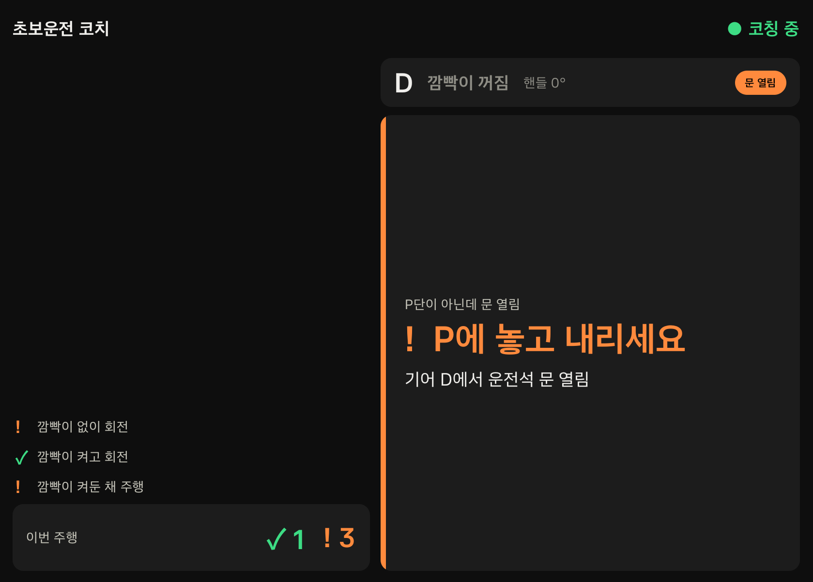
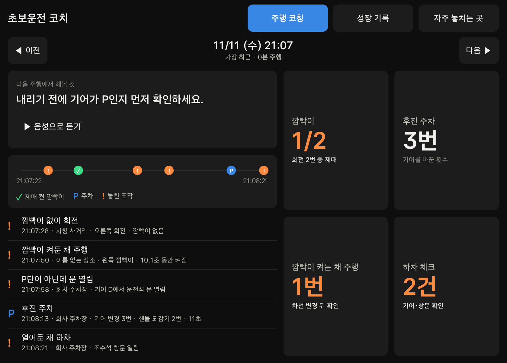
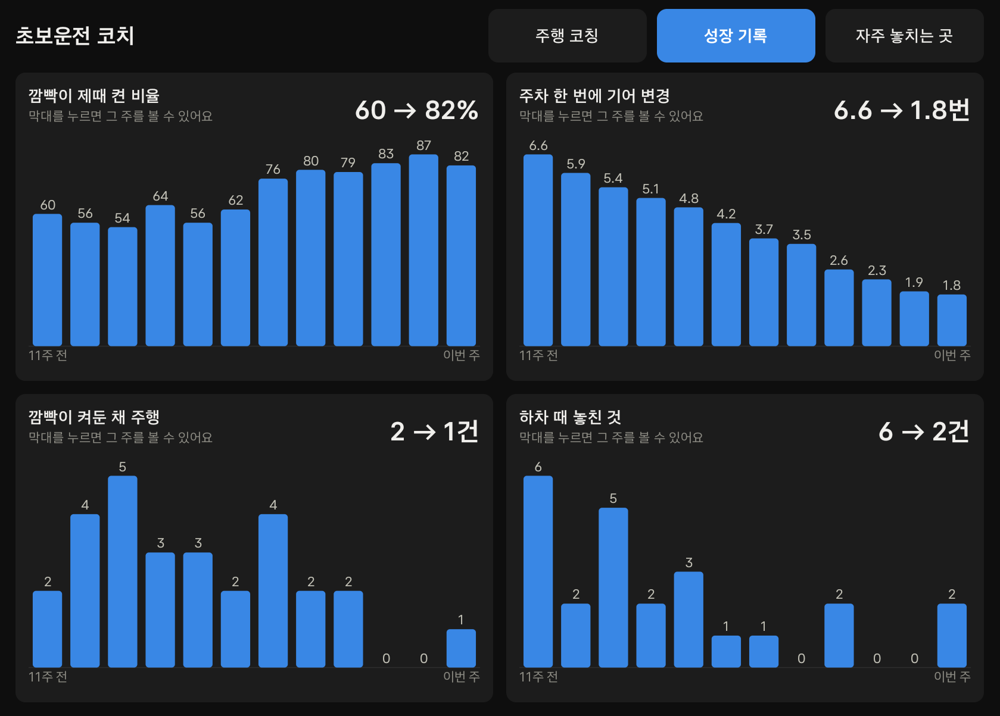
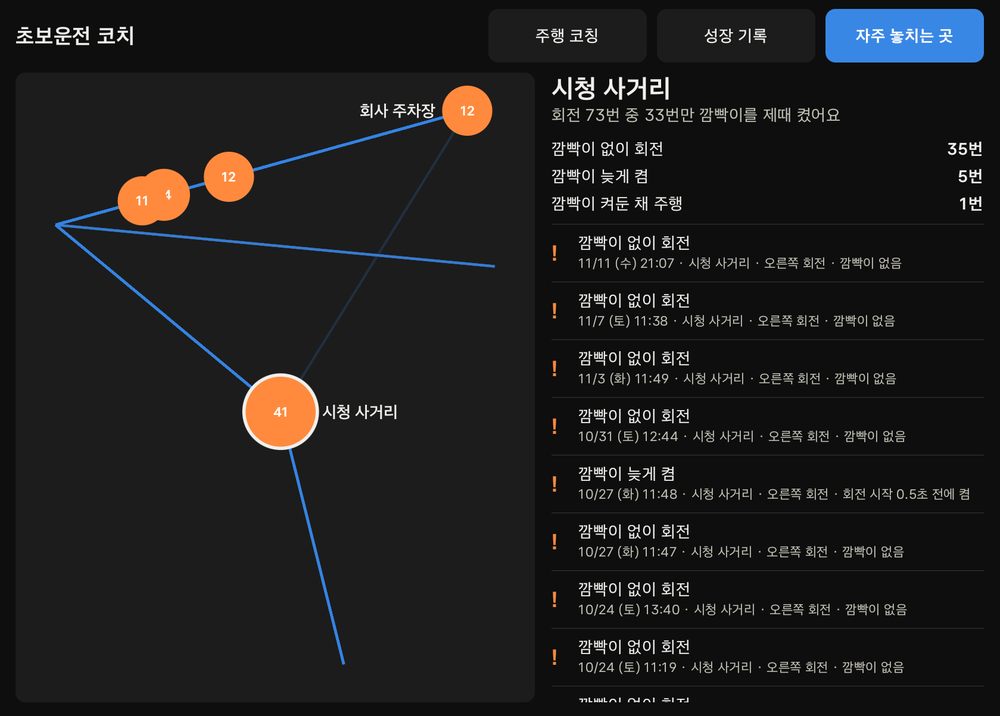

# 초보운전 코치

연수가 끝나 혼자 운전하는 초보 운전자에게, 폰으로는 알 수 없는 **깜빡이·기어·핸들 조작을 차가 직접 보고** 그 순간 음성으로 알려주고, 실력이 느는 과정을 숫자로 보여주는 차량용 앱입니다.

현대자동차그룹 차량용 앱 개발 공모전 출품작 · Pleos Connect (Android Automotive OS) · Vehicle SDK 2.3.2



## 왜 차 안에서만 가능한가

폰 운전 점수 앱은 차의 **움직임**(속도·급가속)만 봅니다. 초보의 실수는 대부분 **조작**에서 나오고, 깜빡이 상태·기어 위치·조향각·문·창문 신호는 차 안에만 있습니다. "핸들을 돌리기 몇 초 전에 깜빡이를 켰는가", "후진부터 P단까지 기어를 몇 번 바꿨는가"는 이 신호들을 시간순으로 엮어야 계산됩니다.

## 기능

| 코칭 | 쓰는 신호 | 그 순간 음성 |
|---|---|---|
| 회전할 때 깜빡이를 제때 켰는가 (제때 / 늦음 / 없음) | 조향각, 깜빡이 | 회전 중에는 말하지 않고 기록만 |
| 깜빡이를 켜둔 채 직진 | 깜빡이, 조향각, 속도 | "왼쪽 깜빡이가 켜져 있어요" |
| 후진 주차의 기어 변경·핸들 되감기 횟수 | 기어, 조향각 | "주차 완료. 기어를 3번 바꿨어요. 평소 5번보다 줄었어요" |
| P단이 아닌데 운전석 문을 엶 | 기어, 문 | "기어가 P가 아니에요. P에 놓고 내리세요" |
| 창문·전조등을 켜둔 채 하차 | 기어, 문, 창문, 전조등 | "조수석 창문이 열려 있어요" |

- **시동을 걸면 자동 시작**: 앱을 열지 않아도 부팅과 함께 코칭 서비스가 돌고, 기어가 P에서 벗어나면 주행 기록이 시작됩니다.
- **주행 중에는 음성만**: Pleos는 차가 움직이면 앱 화면을 가립니다. 실시간 코칭 화면은 신호 대기·주차처럼 멈춰 있을 때 보입니다.
- **기록은 차 안에만**: 기기 내 SQLite에 저장하고 서버로 보내지 않습니다. 운전자 프로필별로 분리됩니다.

| 주행 코칭 | 성장 기록 | 자주 놓치는 곳 |
|---|---|---|
|  |  |  |
| 방금 주행의 요약과 "다음 주행에서 해볼 것" 한 가지 | 지표별 12주 변화. 비교 대상은 지난주의 나 | 놓친 조작을 장소별로 묶어 보여줌 |

## 구조

```
Pleos Vehicle SDK ─▶ PleosSignalSource ─▶ CarState (250ms 샘플링)
                                              │
                                       DetectionEngine (순수 로직) ─▶ Record ─▶ CoachDb (SQLite) ─▶ 화면
                                              │
                                              └▶ Coach (코칭 문장) ─▶ Announcer (Pleos TTS → 기본 TTS)
```

| 패키지 | 역할 |
|---|---|
| `signal` | SDK 구독 → `CarState`, 샘플링·저장·음성(`Recorder`), TTS(`Announcer`) |
| `detect` | 감지 엔진, 기준값(`DetectorConfig`, 차종별 보정 지점), 음성 문구 |
| `coach` | 주행 요약, 팁 한 가지, 주차 피드백 문장 |
| `store` | 주행·기록 저장, 장소 묶기 |
| `ui` | Jetpack Compose 화면 |
| `demo` | 시연용 12주 합성 기록 |

자세한 설계는 [docs/design.md](docs/design.md)에 있습니다.

## 빌드와 실행

요구 사항: Android Studio, Pleos Connect 에뮬레이터 v2.1.0 이상 (빌드에 필요한 JDK는 Gradle이 자동으로 받습니다)

```bash
./gradlew installDebug        # 에뮬레이터에 설치
./gradlew testDebugUnitTest   # 감지·코칭 로직 단위 테스트
```

APK와 시연 영상은 [Releases](../../releases)에서 받을 수 있습니다.

## 시연

PC 스크립트가 Pleos Virtual Console과 에뮬레이터 GPS로 차량 신호를 넣습니다. 신호는 실제 Vehicle SDK 경로로 들어오므로 시연에서 도는 감지 코드는 실차와 같습니다.

```powershell
powershell -ExecutionPolicy Bypass -File demo\demo.ps1        # 단계마다 Enter
powershell -ExecutionPolicy Bypass -File demo\demo.ps1 -Auto  # 끝까지 자동
```

권한 설정과 시연 순서는 [demo/README.md](demo/README.md)를 참고하세요.

## 한계

- 검증은 에뮬레이터 기준입니다. 감지 기준값(회전 조향각 90° 등)은 실차 주행 로그로 보정이 필요합니다.
- 성장 기록 화면의 12주 추이는 시연용 합성 데이터입니다.
- 주차 지표는 후진 주차만 봅니다.
